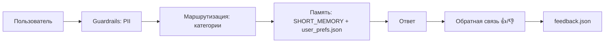

# Telegram AI Equipment Assistant

ИИ-консультант по подбору оборудования в Telegram.

## 🤖 Живое демо
[@my_ai_consultant_bot](https://t.me/ВАШ_USERNAME_БОТА)

## Возможности
- Приветственное меню
- Подбор по категориям (сварка, компрессоры, генераторы, инструмент)
- Уточняющие вопросы
- Обработка неизвестных запросов

## Запуск локально
1. Установите зависимости: `pip install -r requirements.txt`
2. Создайте `.env` с токеном: `BOT_TOKEN=ваш_токен`
3. Запустите: `python bot.py`

## Технологии
Python, aiogram, python-dotenv

## Оценка

- Обратная связь: inline-кнопки 👍/👎 под каждым ответом, запись в `feedback.json`.
- Память: краткосрочная (последние 5 сообщений) + долговременная (`user_prefs.json` — последние 5 категорий пользователя).
- Guardrails: PII-фильтр (email, телефон) маскирует данные перед логированием.
- Проверено локально: `mask_pii`, `remember`, `update_prefs`, `get_prefs` работают корректно.

## Ограничения

- Ответы — по словарю `CATEGORIES` (ключевые слова), без LLM. В демо-режиме без API.
- Память хранится в JSON-файлах локально, без базы данных. Для production нужен Redis или PostgreSQL.
- Дрифт-детектор не реализован (в планах).
- Для production нужно: подключить LLM для генерации ответов, добавить мониторинг дрейфа, расширить guardrails (токсичность).

## Архитектура

